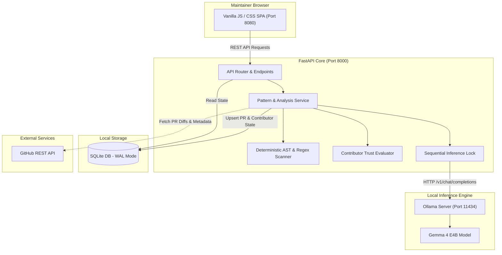

# RAMPART — Repository Automated Monitoring, Pull-request Analysis & Real-time Triage

[](https://fastapi.tiangolo.com)
[](https://www.sqlite.org)
[](https://ollama.ai)
[](https://www.python.org)
[](https://developer.mozilla.org)
[](LICENSE)

> **RAMPART** is an open-source, maintainer-first pull request intelligence and contributor trust platform. It protects maintainers against review fatigue, spam churn, and supply-chain threats by executing local, privacy-first AI analysis using Google's **Gemma 4 E4B** alongside deterministic code-scanning heuristics and decentralized peer trust networks.

---

## Table of Contents
1. [Project Introduction](#1-project-introduction)
2. [Main Features](#2-main-features)
3. [How RAMPART Works & Architecture](#3-how-rampart-works--architecture)
4. [Pull Request Classification](#4-pull-request-classification)
5. [Contributor Trust System](#5-contributor-trust-system)
6. [Priority & Recommendation System](#6-priority--recommendation-system)
7. [Technology Stack](#7-technology-stack)
8. [Prerequisites](#8-prerequisites)
9. [Installation & Setup](#9-installation--setup)
10. [Environment Variables](#10-environment-variables)
11. [GitHub Integration](#11-github-integration)
12. [Local Gemma AI Setup](#12-local-gemma-ai-setup)
13. [How to Use RAMPART](#13-how-to-use-rampart)
14. [REST API Documentation](#14-rest-api-documentation)
15. [Automated Testing Suite](#15-automated-testing-suite)
16. [Troubleshooting Guide](#16-troubleshooting-guide)
17. [Project Structure](#17-project-structure)
18. [Limitations & Future Roadmap](#18-limitations--future-roadmap)
19. [Contributing Guide](#19-contributing-guide)
20. [License & Acknowledgements](#20-license--acknowledgements)

---

## 1. Project Introduction

Open-source maintainers face an escalating crisis of **review fatigue**:
* Mass automated spam, generated by bots or superficial AI wrappers.
* Malicious supply-chain pull requests carrying unparameterized SQL, dynamic code execution (`eval`), and hardcoded secrets.
* High volumes of trivial contributions (e.g., whitespace or formatting edits) that overwhelm maintainer notification queues.
* Promising first-time contributors getting lost in the backlog without timely review.

**RAMPART** solves this problem by providing a fast, self-hosted security and review layer. It runs entirely on the maintainer's local machine—requiring zero cloud LLM subscriptions or external API tokens for inference—ensuring proprietary code and internal diffs **never leave your local environment**.

---

## 2. Main Features

* **9-Section Structured Gemma AI Analysis**: Replaces superficial summaries with rigorous, actionable review dossiers including What Changed, Technical Findings, Potential Bugs & Risks, Security & Reliability, Test Evidence, Recommended Improvements, and Final Advisory Recommendations.
* **Maintainer Sovereignty Principle**: AI reviews and priority flags are strictly advisory. The platform never overrides human maintainer authority.
* **Deterministic AST & Regex Heuristic Engine**: Scans unified diff hunks for SQL injection interpolation, dynamic execution functions (`eval`, `exec`, `os.system`), sensitive credentials (`ghp_`, `sk_live_`), and sensitive configuration paths.
* **Cross-Repository Contributor Trust Network**: Tracks peer maintainer endorsements (`VOUCH`) and abuse reports (`DENOUNCE`) backed by verifiable GitHub issue/PR URLs.
* **Anti-Bias Newbie Protection**: New contributors receive a fair, neutral baseline (`50.0` score) and are never penalized solely for being new.
* **Zero-Cloud Local Inference**: Integrated with Ollama running `gemma4:e4b` on Apple Silicon / local hardware. Features thread-safe single-concurrency queuing to protect system memory.
* **Content-Hash Caching**: Recomputes PR analysis only when the underlying commit hash or diff content changes, avoiding redundant GPU/CPU inference.
* **Automated Evidence-Based Alerts**: Automatically detects duplicate PR submissions submitted across multiple connected repositories within short time windows.

---

## 3. How RAMPART Works & Architecture

RAMPART operates as a high-performance decoupled system: a lightweight Vanilla JS single-page application communicating with an asynchronous FastAPI backend backed by SQLite in Write-Ahead Logging (WAL) mode.



### Analysis Lifecycle
1. **Ingestion**: A pull request is ingested via GitHub API sync, webhook, or the interactive repository discovery UI.
2. **Deterministic Scan**: The unified diff is parsed into file hunks and evaluated for dangerous code patterns, sensitive file alterations, and missing test files.
3. **Trust Baseline**: The author's historical activity and cross-repository vouch/denounce records are computed.
4. **Local Gemma Inference**: High-priority diff hunks are formatted into a structured prompt and evaluated by `gemma4:e4b` under a thread-safe mutex lock.
5. **Dossier Generation**: A unified 9-section review report is persisted to SQLite and rendered in the frontend detail modal.

---

## 4. Pull Request Classification

RAMPART classifies pull requests into distinct quality categories and risk levels:

### Quality Categories
* **`GOOD`**: Well-structured contributions that include clear implementations, corresponding automated unit tests, and no detected code vulnerabilities.
* **`AVERAGE`**: Standard substantive code additions or refactorings that lack accompanying test coverage or contain minor non-critical stylistic omissions.
* **`FLAGGED`**: Contributions containing verifiable high-risk patterns (SQL injection, shell execution, credential leaks) or submitted by accounts with active peer denouncements.
* **`SPAM`**: Churn pull requests characterized by trivial non-functional modifications (whitespace, blank lines, typo churn across unrelated repos).

### Risk Levels
* **`LOW`**: Clean features with tests, non-executable markdown/documentation updates, or minor configuration adjustments.
* **`MEDIUM`**: Substantive business logic modifications without unit tests, or alterations to complex database queries.
* **`HIGH`**: Insecure input sanitization, dynamic code execution, credential exposure, or cross-repository spam behavior.

---

## 5. Contributor Trust System

Maintainers often lack context when evaluating pull requests from unfamiliar developers. RAMPART introduces a verifiable peer trust graph:

```text
Trust Score: 0.0 (Flagged/Abusive) <---> 50.0 (Neutral Baseline) <---> 100.0 (Trusted Core)
```

### Contributor Classifications
* **`TRUSTED` (Score: 80.0 – 100.0)**: Established maintainers or verified contributors with extensive merged contributions and peer endorsements.
* **`ESTABLISHED` (Score: 65.0 – 79.9)**: Regular contributors with multiple merged pull requests and positive reputation.
* **`BEGINNER` / `NEUTRAL` (Score: 40.0 – 64.9)**: New contributors in good standing. Evaluated fairly with standard code review.
* **`FLAGGED` (Score: 0.0 – 39.9)**: Accounts associated with active denouncements, cross-repo spamming, or malicious pull requests.

### Peer Vouches and Denouncements
Maintainers can vouch for reliable contributors or denounce abusive actors directly from the UI. Every vouch and denounce requires:
* Verifiable GitHub Issue or Pull Request Evidence URL
* Specific maintainer reason and rationale
* Source repository attribution

---

## 6. Priority & Recommendation System

To prevent maintainer backlog gridlock, RAMPART computes a priority triage badge and an advisory AI recommendation:

### Maintainer Priority Badges
* **`PRIORITY REVIEW`**: High-quality PR from an established or trusted contributor. Fast-track for merging.
* **`REVIEW — PROMISING CONTRIBUTION`**: Clean, well-tested PR from a newer contributor. Encourages community growth.
* **`NORMAL REVIEW`**: Standard code contribution requiring ordinary review and testing.
* **`HIGH-RISK FLAG`**: High-risk code patterns detected or contributor flagged. Requires senior maintainer audit.
* **`SPAM`**: Trivial churn or mass automated submission. Candidate for rapid closure.

### Advisory AI Recommendations
* **`APPROVE`**: Change is well-reasoned, tested, and carries negligible architectural or security risk.
* **`REQUEST CHANGES`**: Specific defects, missing test coverage, or security vulnerabilities identified.
* **`NEEDS HUMAN REVIEW`**: Complex architectural refactoring requiring human domain judgment.

> [!IMPORTANT]
> **Maintainer Sovereignty**: RAMPART never auto-merges or auto-closes pull requests. All recommendations are advisory aids designed to empower human maintainers.

---

## 7. Technology Stack

* **Backend**: FastAPI 0.115+, Uvicorn, Python 3.11+, Pydantic.
* **Database**: SQLite 3 with Write-Ahead Logging (`WAL`), 60s busy timeout, and thread-safe connection pooling.
* **Inference Engine**: Ollama with `gemma4:e4b` model (OpenAI-compatible REST API at `http://127.0.0.1:11434/v1`).
* **Frontend**: Vanilla ECMAScript 6+, semantic HTML5, modern CSS3 with responsive grid layout and dark theme. Zero bundlers or node runtime required for frontend serving.
* **Integration**: GitHub REST API v3 via `httpx`.

---

## 8. Prerequisites

Before installing RAMPART, ensure your system meets the following requirements:

1. **Operating System**: macOS (Apple Silicon recommended for fast ML inference), Linux, or Windows (WSL2).
2. **Python**: Python 3.10, 3.11, or 3.12 installed.
3. **RAM**: Minimum 8 GB unified memory (16 GB recommended for seamless local LLM inference).
4. **Ollama**: Installed and running locally.
5. **Gemma 4 E4B Model**: Downloaded via `ollama pull gemma4:e4b`.

---

## 9. Installation & Setup

Follow these step-by-step instructions to get RAMPART running locally:

### Step 1: Clone the Repository
```bash
git clone https://github.com/Rounak-2008/Rampart-.git rampart
cd rampart
```

### Step 2: Create and Activate a Python Virtual Environment
```bash
python3 -m venv .venv
source .venv/bin/activate
```

### Step 3: Install Backend Dependencies
```bash
pip install --upgrade pip
pip install -r backend/requirements.txt
```

### Step 4: Configure Environment Variables
```bash
cp .env.example .env
# Optional: Edit .env to supply your GitHub Personal Access Token
```

### Step 5: Start Local Ollama Server and Pull Model
In a separate terminal window:
```bash
ollama pull gemma4:e4b
ollama serve
```

### Step 6: Start the FastAPI Backend
```bash
python3 run_backend.py
# Backend runs at: http://127.0.0.1:8000
# OpenAPI Docs:   http://127.0.0.1:8000/docs
```

### Step 7: Start the Frontend HTTP Server
In a separate terminal window:
```bash
python3 -m http.server 8080 --bind 127.0.0.1
# Frontend dashboard available at: http://127.0.0.1:8080/index.html
```

---

## 10. Environment Variables

RAMPART uses `.env` in the project root or `backend/.env`. Refer to [.env.example](.env.example) for defaults:

| Variable | Default Value | Description |
| :--- | :--- | :--- |
| `DATABASE_PATH` | `rampart.db` | Path to the SQLite database file. |
| `OLLAMA_BASE_URL` | `http://127.0.0.1:11434` | Base URL for the local Ollama daemon. |
| `OLLAMA_MODEL` | `gemma4:e4b` | Specific Ollama model tag used for PR analysis. |
| `GITHUB_TOKEN` | *empty* | Optional GitHub Personal Access Token for higher rate limits. |
| `BACKEND_PORT` | `8000` | Port for the FastAPI server. |
| `BACKEND_HOST` | `127.0.0.1` | Host interface binding for the backend. |

> [!CAUTION]
> Never commit real GitHub tokens, private keys, or `.env` files to source control. `.env` is explicitly ignored in `.gitignore`.

---

## 11. GitHub Integration

### Personal Access Token (Recommended)
While RAMPART can evaluate local patches and public GitHub repositories without authentication, supplying a GitHub token increases the hourly API rate limit from 60 to 5,000 requests:
1. Navigate to GitHub Settings -> Developer Settings -> Personal Access Tokens (Classic or Fine-Grained).
2. Required permissions: `public_repo` (or `repo` for private repositories).
3. Set `GITHUB_TOKEN=ghp_yourTokenHere` in `.env`.

### Webhook Integration (Optional)
To receive live real-time push and PR events:
1. In your GitHub repository settings, click **Webhooks** -> **Add webhook**.
2. Set Payload URL to: `https://your-domain.com/api/webhooks/github`.
3. Select content type: `application/json`.
4. Select individual events: **Pull requests** and **Pull request reviews**.

---

## 12. Local Gemma AI Setup

RAMPART is engineered specifically to maximize efficiency on developer machines without cloud dependency:

### Single Concurrency Mutex
Local inference runs through an asynchronous mutex lock (`asyncio.Lock` / `threading.Lock`) ensuring only **one PR is analyzed at a time**. This prevents memory pressure spikes and protects 16 GB Apple Silicon machines from swapping.

### Hunk Prioritization & Chunking
Large pull request diffs are intelligently chunked:
1. Files are categorized into `Security/Sensitive` > `Core Logic` > `Config` > `Tests` > `Documentation`.
2. Unified diff patches are bounded to ~3,500 characters, retaining hunk line headers (`@@ -L,N +L,N @@`) so Gemma analyzes exact line modifications.

### Transparent Deterministic Fallback
If Ollama is stopped, busy, or offline, RAMPART transparently falls back to its deterministic AST/regex engine, synthesizing an identical 9-section structured dossier with status `offline_fallback`.

---

## 13. How to Use RAMPART

The user interface is organized into 7 focused views accessible via the sidebar:

1. **Dashboard (`index.html`)**: Real-time overview of connected repositories, open PRs, pending reviews, risk distributions, and recent maintainer actions.
2. **Repositories (`pages/repositories.html`)**: Connect, inspect, search, and synchronize GitHub repositories.
3. **Pull Requests (`pages/pull-requests.html`)**: Interactive triage board. Displays PR titles, authors, quality badges, maintainer priority, and single `👁️ View` action to inspect the 9-section dossier modal.
4. **Contributors (`pages/contributors.html`)**: Contributor roster with trust scores, merged/rejected ratios, status badges, and quick Vouch/Denounce controls.
5. **Trust Network (`pages/trust-network.html`)**: Cross-repository peer reputation graph showing active endorsements, abuse denouncements, and evidence URLs.
6. **Alerts (`pages/alerts.html`)**: High-priority notifications for duplicate PR spam, critical code vulnerabilities, and cross-repo abuse history.
7. **Notifications (`pages/notifications.html`)**: Audit trail of completed analyses, newly discovered repositories, and peer vouch events.

---

## 14. REST API Documentation

FastAPI automatically generates interactive OpenAPI documentation at `http://127.0.0.1:8000/docs`. Key endpoints include:

* `GET /api/health` — System status, database health, and Ollama connectivity.
* `GET /api/pull-requests` — List pull requests with filtering by repo, status, and risk.
* `POST /api/pull-requests/{id}/analyze` — Trigger local Gemma AI analysis on a pull request.
* `GET /api/repositories` — List connected repositories.
* `POST /api/repositories` — Connect a new GitHub repository.
* `GET /api/contributors` — List contributors with trust scores and history.
* `POST /api/trust-records` — Submit a peer Vouch or Denounce with URL evidence.
* `GET /api/alerts` — Fetch unresolved security and spam alerts.

---

## 15. Automated Testing Suite

RAMPART includes comprehensive automated test suites:

```bash
# 1. Run Core API and Database Integration Tests (31 tests)
PYTHONPATH=backend python3 backend/test_api.py

# 2. Run Advanced Feature Tests (Gemma schema, content-hash, trust math)
PYTHONPATH=backend python3 backend/test_advanced_features.py

# 3. Run the PR Analysis Benchmark Examples Suite
PYTHONPATH=backend python3 examples/run_examples.py

# 4. Verify Frontend JavaScript Syntax
node --check pages/*.js js/*.js
```

---

## 16. Troubleshooting Guide

### 1. `OLLAMA_UNAVAILABLE` or Connection Refused
* **Symptom**: PR analysis shows status `offline_fallback` and log says `Connection refused`.
* **Solution**: Ensure Ollama is running (`ollama serve`). Verify that `curl http://127.0.0.1:11434/api/tags` returns your installed models.

### 2. `sqlite3.OperationalError: database is locked`
* **Symptom**: Database queries timeout during concurrent writes.
* **Solution**: RAMPART uses SQLite in Write-Ahead Logging (`WAL`) mode with a 60-second busy timeout. Ensure you do not hold open uncommitted SQLite transactions across external network or AI inference calls.

### 3. Port Conflicts (`8000` or `8080` in use)
* **Symptom**: Backend or frontend fails to start with `Address already in use`.
* **Solution**: Check active processes with `lsof -i:8000` or `lsof -i:8080` and terminate the conflicting process with `kill -9 <PID>`.

---

## 17. Project Structure

```text
.
├── backend/
│   ├── app/
│   │   ├── config.py                 # Configuration and environment loaders
│   │   ├── database.py               # SQLite schema, WAL mode, connection context
│   │   ├── main.py                   # FastAPI application initialization & CORS
│   │   ├── routes/
│   │   │   ├── alerts.py             # Security and spam alert endpoints
│   │   │   ├── contributors.py       # Contributor management & trust calculations
│   │   │   ├── dashboard.py          # Dashboard aggregated metrics
│   │   │   ├── pull_requests.py      # Pull request routes & analysis triggers
│   │   │   ├── repositories.py       # GitHub repository connection & sync
│   │   │   └── trust_network.py      # Peer vouch and denounce records
│   │   └── services/
│   │       ├── github_service.py     # GitHub REST API client & diff fetcher
│   │       └── pattern_service.py    # Local Gemma 4 E4B pipeline & heuristics
│   ├── requirements.txt              # Backend dependencies
│   ├── test_api.py                   # Core API test suite
│   └── test_advanced_features.py     # Advanced features test suite
├── examples/
│   ├── README.md                     # Examples guide
│   ├── run_examples.py               # Automated example suite runner
│   ├── example_01_good_pr/           # Feature with unit tests
│   ├── example_02_average_pr/        # Refactor without tests
│   ├── example_03_risky_pr/          # SQL injection security risk
│   └── example_04_spam_pr/           # Trivial whitespace churn
├── js/                               # Shared frontend utilities & API client
├── pages/                            # Frontend views (HTML + JS)
├── run_backend.py                    # Root script to run FastAPI backend
├── .env.example                      # Reference environment variable configuration
└── README.md                         # This documentation
```

---

## 18. Limitations & Future Roadmap

* **Sequential Inference**: Current local LLM inference is strictly sequential (`concurrency = 1`) to preserve RAM on single developer laptops. Future releases will support distributed Ollama workers.
* **Static Context Window**: Diffs exceeding 4,000 characters are intelligently truncated with file priority. Planned updates include hierarchical AST multi-turn chunking.
* **Ecosystem Support**: Currently optimized for Python, JavaScript/TypeScript, and Markdown. Extensibility for Go, Rust, and Java AST parsers is on the roadmap.

---

## 19. Contributing Guide

We welcome contributions to RAMPART! Please follow these standards:
1. Fork the repository and create a feature branch (`git checkout -b feat/my-improvement`).
2. Adhere to PEP 8 for Python code and modern standard JS syntax.
3. Run the full test suite (`python3 backend/test_api.py` and `node --check pages/*.js`).
4. Ensure all new features include unit tests in `backend/test_api.py` or `backend/test_advanced_features.py`.
5. Open a pull request with a descriptive title and evidence of local verification.

---

## 20. License & Acknowledgements

RAMPART is released under the **MIT License**.

Special thanks to:
* The **Google DeepMind** team for releasing open **Gemma** models.
* The **Ollama** project for high-performance local AI runtime.
* The **FastAPI** and **Starlette** maintainers for modern asynchronous Python tooling.
